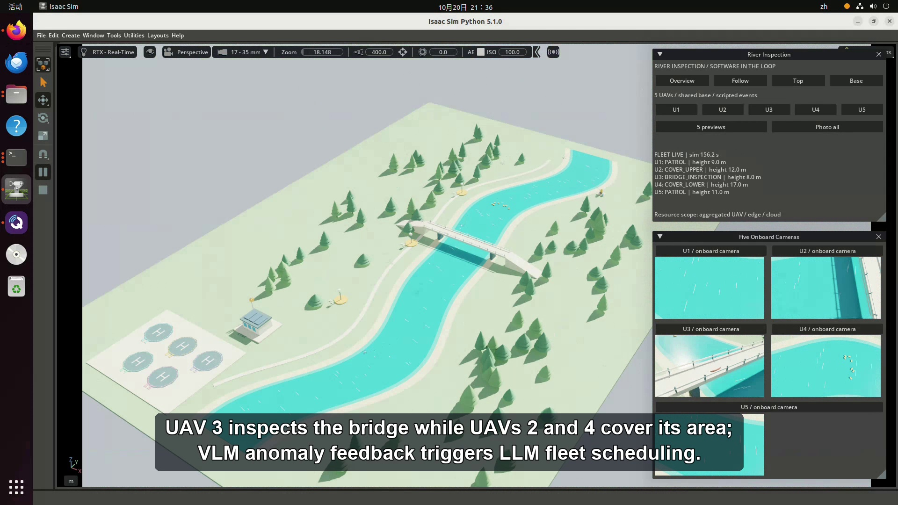

# Isaac Sim River Inspection Demo


Editable river-scene models and an English narrated demonstration of a five-UAV inspection workflow.


[](https://github.com/water1370074517-design/isaac-river-inspection-demo/releases/download/v1.0/river_inspection_demo_en.mp4)


## Video and downloads

If you prefer not to download the video, you can [watch it online](https://water1370074517-design.github.io/isaac-river-inspection-demo/). Online playback may be choppy; for a smoother viewing experience, please download the video.


- [English video with subtitles and narration](https://github.com/water1370074517-design/isaac-river-inspection-demo/releases/download/v1.0/river_inspection_demo_en.mp4) — MP4, 1920 × 1080, about 7 min 52 s.
- [Scene models and source code ZIP](https://github.com/water1370074517-design/isaac-river-inspection-demo/releases/download/v1.0/isaac_river_scene.zip).
- [All release assets](https://github.com/water1370074517-design/isaac-river-inspection-demo/releases/tag/v1.0).
- [Editable English subtitles](subtitles_en.srt).


The video is a workflow demonstration of LLM task/route planning and VLM visual inspection in a scripted simulation scenario. The scene files define the environment and reference regions; they do not implement live LLM/VLM inference.


## Editable Isaac / OpenUSD scene


Open `river_fleet.usda` in Isaac Sim to view the five-aircraft inspection environment, or `river.usda` for the original single-base scene.


The scene contains a curved river, riverbanks, trees, paths, a bridge, shore stations, five helipads, and inspection landmarks. Geometry and materials are native USD primitives, with no external textures or referenced asset downloads. Coordinates are metres with Z up; the default prim is `River`. The water is a visual surface.


The USD files contain static scene geometry exported from the included source snapshot. Aircraft dynamics, PX4, Pegasus, ROS 2, runtime cameras and the flight controller are separate integrations, and are not bundled here. The recorded demonstration used Isaac Sim 5.1.0 with Pegasus/PX4.


## Edit and regenerate


Python 3.10 or newer is sufficient for scene export; only the standard library is required.


```bash
python export_scene.py --fleet --output river_fleet.usda
python export_scene.py --output river.usda
```


- `scene_spec.py`: procedural river, bridge, vegetation, shore stations and material colours.
- `fleet_spec.py`: five helipads, patrol-region specifications, bridge and riverbank landmarks.
- `export_scene.py`: exports native USDA geometry and JSON scene metadata.
- `validate_scene.py`: optional OpenUSD validation, using an environment with `pxr` or Isaac Sim's Python.


```bash
python validate_scene.py --asset river_fleet.usda
```


`SHA256SUMS.txt` lists checksums for the shared files. `RELEASE_SHA256SUMS.txt` in Releases lists the video and ZIP checksums.

